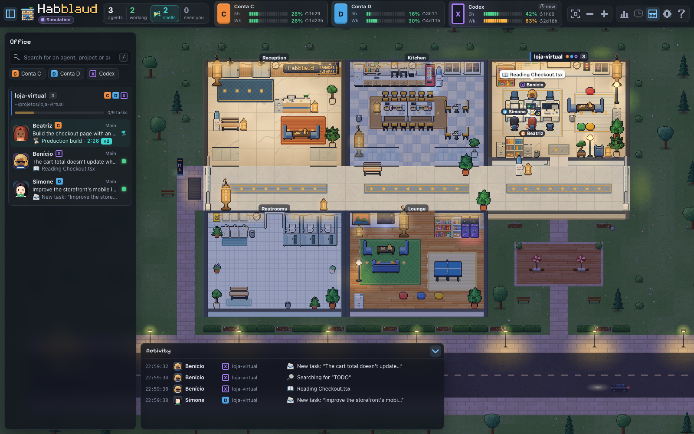
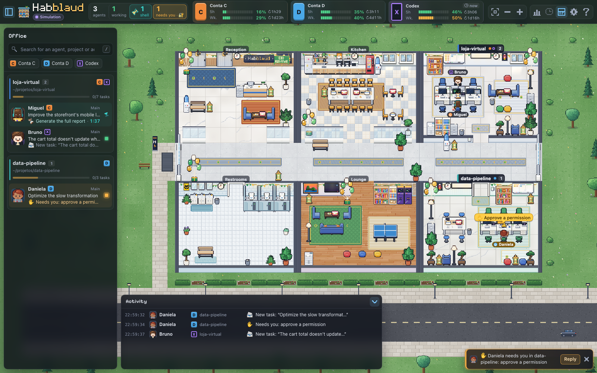

<p align="center">
  
</p>

<h1 align="center">Habblaud</h1>

<p align="center">
  <b>The virtual office for your Claude Code (and Codex) agents.</b><br />
  Each project becomes a room, and each agent becomes a pixel-art character that shows, in real time, what it's doing.
</p>

<p align="center"><b>English</b> · <a href="README.pt-BR.md">Português</a> · <a href="README.es.md">Español</a> · <a href="README.fr.md">Français</a></p>

<p align="center">
  
  
  
  
  
</p>

<p align="center">
  
</p>

---

You open Claude Code in several projects, launch subagents, leave tasks running… and lose track of who's doing
what. **Habblaud** turns all of that into an office you can take in at a glance: who's typing, who raised a hand
because they **need you**, who delivered their work and left, who went for a coffee while waiting for the next
instruction — and how much of each account you've already used in the 5-hour session and in the week.

And when two or more agents have nothing to do, the office gets a **social life**: each one has its own personality,
and they watch soccer together in the lounge, play video games and ping-pong, gossip in the kitchen, freshen up at the
mirror and bet coins on rock-paper-scissors. See [Social life](#social-life).

Everything runs on your machine, reading the files Claude Code itself already writes (plus only the `alias` lines in
your shell, to give each account its letter). Nothing leaves the computer: Habblaud doesn't read credentials or make
external calls.

## Contents

- [What it looks like](#what-it-looks-like)
- [Installation](#installation)
- [How to use](#how-to-use)
- [Accounts and usage (5-hour and weekly)](#accounts-and-usage-5-hour-and-weekly)
- [Configuration](#configuration)
- [How it works](#how-it-works)
- [Privacy and security](#privacy-and-security)
- [Development](#development)
- [Troubleshooting](#troubleshooting)
- [Disclaimer](#disclaimer)
- [License](#license)
- [Social life](#social-life)

## What it looks like

**Overview.** The building has a lobby with elevators, a kitchen, restrooms and a lounge; each project with an open
session gets its own room along the hallway. At the top, the counters and each account's usage; on the left, the rooms
and agents; at the bottom, the activity feed. When several sessions share one folder (Remote Control starts them all in
the same one), `HABBLAUD_ROOMS=auto` gives each of them its own room, named after the session's title.


<table>
  <tr>
    <td width="50%"></td>
    <td width="50%"></td>
  </tr>
  <tr>
    <td><b>Agent details:</b> current activity, tasks with progress, subagents, timeline and stats.</td>
    <td><b>Day and night:</b> the sky in the windows and the lighting follow local time.</td>
  </tr>
</table>

<table>
  <tr>
    <td width="42%"></td>
    <td width="58%">
      <b>Collaboration in plain sight.</b> Subagents are coworkers with their own names and badges: they arrive by elevator, work in
      the project's room and, when they finish, walk over to the agent that called them to deliver the result (📦) before leaving.<br /><br />
      <b>Needs you.</b> When an agent is waiting for a permission or an answer in the terminal, it rushes to its desk and
      raises a hand, with a blinking alert — and a notice pops up on screen (optionally with sound and a browser notification).
      You can approve, answer the question or send the next instruction right there.
    </td>
  </tr>
</table>

<table>
  <tr>
    <td width="58%">
      <b>Waiting on shell.</b> When the agent finishes its turn but leaves a command running (tests, build,
      deploy…), it doesn't wander off: it stays at its desk with an hourglass flipping over its head, the terminal showing
      progress and a bubble with the command and the elapsed time. And the wait turns into comedy: first it eats popcorn watching the
      terminal; after 3 min it crosses its arms and spins in its chair; after 10 min it gathers cobwebs; after
      25 min it dozes off. When the command finishes, it stands up and celebrates with confetti — or gets a rain cloud, if
      it failed. In the sidebar list and in the details, a timer shows how long each command has been running.
    </td>
    <td width="42%"></td>
  </tr>
</table>

**The lights go out.** When you close a project's last session, the last character walks to the light switch,
turns off the lights and leaves by elevator — and the room is taken apart, becoming a garden until a new project
arrives. If the garden ended up between two rooms, the farthest room moves there: it's set up in the empty spot,
everyone walks over to it, and the old address goes dark and is taken apart. That way the building has no gaps and
shrinks on its own.

| 1. The room is set up, still dark | 2. Someone turns on the lights and everyone works | 3. The last one leaves and turns off the lights | 4. The room becomes a garden |
| --- | --- | --- | --- |
|  |  |  |  |

<table>
  <tr>
    <td width="34%"></td>
    <td>
      <b>On your phone too.</b> The interface adapts to small screens: account usage stays at the top, the room list
      becomes a drawer and the details open from the bottom up. See how to allow access over the local network in
      <a href="#open-on-your-phone-optional">Open on your phone</a>.
    </td>
  </tr>
</table>

> The images above use **demo mode** (made-up projects, people and accounts).

## Installation

### Requirements

- **macOS** (tested) or Linux.
- **[Claude Code](https://code.claude.com)** installed, with one or more accounts (2.1.287 or newer for the mod).
- **Node.js 22.12+** and **npm** (developed with Node 24; Docker already uses Node 24).
- **Docker Desktop** (or Docker Engine with Compose v2), if you're going to run it in a container.

### 1. Get the project

```bash
git clone https://github.com/marmottajr/habblaud.git
cd habblaud
npm install
```

> `npm install` only downloads build tools (Vite, TypeScript, tsx…). The Habblaud server has no
> runtime dependencies: it only uses Node's built-in modules.

### 2. Start Habblaud

**Option A — Docker (recommended for keeping it always on)**

```bash
npm run docker:up
```

The script detects your Claude Code accounts, mounts only the folders it needs (read-only), builds
the image and starts the container — which restarts on its own along with Docker. Open **http://localhost:4747**.

**Option B — Node, without Docker**

```bash
npm run build
npm start
```

Open **http://localhost:4747**. For development, use `npm run dev` (server + Vite with hot reload).

Now open Claude Code in any project and watch your agent arrive by elevator. 🎉

### 3. Install the Habblaud mod in Claude Code (recommended)

```bash
npm run mod:install                        # o mod e os plugins de permissões e de mensagens, em cada conta
npm run mod:install -- --sem-permissoes    # sem responder permissões e perguntas pelo escritório
npm run mod:install -- --sem-mensagens     # sem mandar mensagens aos agentes pelo escritório
```

Habblaud ships a [mod](https://code.claude.com/docs/en/plugins/mods/overview) (a plugin that runs inside
Claude Code) and installs it in each account, through `claude plugin` itself, from this folder. With it:

- each account's **5-hour and weekly usage** shows up live in Habblaud;
- the terminal shows a line when **another session needs you** (permission or answer);
- the **`/habblaud`** command becomes available in Claude Code;
- you can **approve or deny permission requests from the office** ("Do you want to…") and **answer the agent's
  questions**, with the `habblaud-permissoes` plugin (see [Answering from the office](#answering-from-the-office));
- you can **send messages** to the agent from the office, as if you were typing in its terminal, with the
  `habblaud-mensagens` plugin (see [Sending messages](#sending-messages)).

It requires **Claude Code 2.1.287 or newer** (`claude --version`). The mod runs inside each session, with your
permissions, and only accesses what is listed in [`mod/README.md`](mod/README.md); to check without running anything,
`claude plugin validate mod/habblaud` shows the events it handles and the calls it makes. Sessions that are already open
load the mod with `/reload-plugins` (or when reopened). If the account had the old setup (below), `mod:install` removes the
tap and the hook from `settings.json` (with a backup), because the mod does the same thing. Check with `npm run mod:status`; to
undo: `npm run mod:uninstall`.

> The mod is loaded from this folder. If you move the folder, run `npm run mod:install` again.

<details>
<summary><b>Claude Code older than 2.1.287: the old way</b></summary>

Without mods, live usage and answering from the office come from two installers that edit each account's
`settings.json` (with a backup first):

```bash
npm run usage:install    # põe um "tap" na frente do statusline de cada conta, que captura o uso de 5h/semanal
npm run hooks:install    # acrescenta o hook PermissionRequest, para responder permissões pelo escritório
```

Your statusline keeps looking the same. To undo: `npm run usage:uninstall` and `npm run hooks:uninstall`.
Both point to this folder: if you move the folder, run them again (until then, the accounts' statusline shows an error).
When you update Claude Code, switch to the mod: `npm run mod:install` removes the old tap and hook (with a backup) so
you don't end up with two of them capturing usage or answering the same request.

</details>

### 4. Codex in the office (optional)

If you also use OpenAI's **Codex** (the `codex` CLI or the app), its sessions join the same office: each
project is a room — the same room as Claude Code, when both are open in the same project — and each session is a
character with the **CODEX** tag. Habblaud finds the Codex folder on its own (`~/.codex`, `CODEX_HOME` or `~/.codex*`) and
reads the conversations, without installing anything. To see Codex **live** (what it's doing right now, who needs you) and
approve commands from the office, install the hooks:

```bash
npm run codex:install      # acrescenta os hooks do Habblaud em ~/.codex/hooks.json (backup antes; os outros ficam)
npm run codex:status       # confere
```

Then **open Codex and approve the Habblaud hooks in `/hooks`**: Codex only runs a new hook after you
approve it (Habblaud never writes that approval). With Habblaud in Docker, to send messages to Codex sessions,
also keep `npm run codex:bridge` running on the Mac (see [Codex](#codex)).

### Open on your phone (optional)

By default Habblaud only accepts connections from the computer it runs on. To open it on your phone (on the same Wi-Fi), with Docker:

```bash
printf 'HABBLAUD_BIND=0.0.0.0\n' > .env
npm run docker:up -- --no-build
```

Then open `http://<ip-do-computador>:4747` on your phone (on macOS: `ipconfig getifaddr en0`; if it comes back empty,
`ipconfig getifaddr en1`). In Node mode, use `HABBLAUD_HOST=0.0.0.0 npm start`.

> ⚠️ With this, any device on the network can see the agents' activity (commands, files, session titles). Use it
> only on trusted networks. The [terminal](#terminal) (and with it, answering and sending messages from the office) stays
> off while the port is exposed. To go back: delete `.env` and run `npm run docker:up -- --no-build`.

#### Phone with login and HTTPS (approving requests)

Instead of exposing the main port, open a **second port with a username, a password and HTTPS**. Port 4747 stays on the
computer only (hooks, plugins and your browser keep working without a login); the remote port goes to the network and
every request on it requires a login. What separates the two is the port the connection arrived on, never the Host
header. Nothing of this exists until you run the setup: without it, no extra port is published.

```bash
npm run remote:setup   # usuário, senha, nome do endereço e (opcional) um endereço próprio
npm run docker:up
```

`remote:setup` writes only the password **hash** (scrypt) to `.env`, creates a local CA and the server certificate in
`~/.habblaud/remote-tls`, and leaves a service announcing `<nome>.local` on the network (mDNS; LaunchAgent on macOS,
systemd on Linux). Open `https://<nome>.local` on your phone (with `:4748` if port 443 was taken). The first time,
accept the warning, tap **Install the Habblaud certificate** and trust it (iPhone: Settings › Profile Downloaded ›
Install, then Settings › General › About › Certificate Trust Settings; Android: Security › Encryption & credentials ›
Install a certificate › CA certificate), checking the fingerprint the setup showed.

- **Restricted CA:** it only signs `localhost`, `.local` names, your own address and private-network IPs. Even if its
  key leaked, a certificate for any other site would be rejected by the phone that trusts it. Changing your own
  address creates a new CA (install the certificate on the phone again). The CA key never goes into the container.
- **Own address** (e.g. `meuclaude.home`): goes into the certificate, but the phone only finds it with an entry in the
  router's DNS pointing to the computer's IP. `<nome>.local` works without configuring anything.
- **What the phone can do:** by default, approve and deny permission requests. `HABBLAUD_REMOTE_ALLOW` in `.env`
  accepts `permissions`, `messages`, `terminal` and `spawn`, separated by commas, or `none` (view only). The
  interactive terminal never works from the phone.
- **Deliveries** (phone, with `terminal` allowed): the box button in the top bar lists what each agent finished, with
  a summary and attachments (screenshots, PDFs, files it sent) that open with a tap.
- **New agent** (the **+** button): starts a Claude Code session in the background on the computer (`claude --bg`, in
  the chosen folder), which shows up in the office and receives messages and permission requests through Habblaud. In
  a folder Claude Code doesn't trust yet, it opens the Claude app's new-session screen filled in, and you press Enter
  there. **It comes turned off:** it needs `HABBLAUD_PTY=1` (the same opt-in as the
  [interactive terminal](#interactive-terminal-take-over-new-session-and-end); in Docker, put it in `.env` and keep
  `npm run codex:bridge` running on the computer) and, from the phone, `spawn` in `HABBLAUD_REMOTE_ALLOW` too.
- **Dictation** (in New agent and in the message box): needs `whisper-cli` and `ffmpeg` (`brew install whisper-cpp
  ffmpeg`) and a multilingual model in `~/.local/share/whisper/` (`ggml-small.bin` gets more right than
  `ggml-base.bin`; the `.en` ones only understand English). Without them, the Dictate button doesn't show up. The
  voice never leaves the computer. `HABBLAUD_WHISPER_BIN`, `HABBLAUD_FFMPEG_BIN`, `HABBLAUD_WHISPER_MODEL` and
  `HABBLAUD_DICTATION_LANGS` (default `pt,en`) adjust it.
- **Away from home (Tailscale):** with Tailscale on the computer and on the phone, `tailscale serve --bg --https=443
  https+insecure://127.0.0.1:443` publishes the remote port (with login) only to your devices, with a valid
  certificate at `https://<computador>.<tailnet>.ts.net`; add that name to `HABBLAUD_ALLOWED_HOSTS`. Always point it at
  the remote port, never at 4747 (which has no login).
- **Session:** 30 days; changing the password (running the setup again) ends all of them, and **Settings › Phone
  access › Sign out** ends the one on that device. After 5 wrong passwords in a row, each new attempt waits from 1 s up to 5 min.
- **IP changed?** `docker:up` re-issues the server certificate when the new IP is missing or when it's 30 days from
  expiring, with the same CA (the phone keeps trusting it); the server swaps the certificate without restarting.
- **Turn off:** `npm run remote:setup -- --off` and `npm run docker:up`.

Without HTTPS the remote port doesn't start; `HABBLAUD_REMOTE_INSECURE_HTTP=1` forces plain HTTP (password and cookie
in the clear on the network). In Node mode: `HABBLAUD_REMOTE_PORT` and `HABBLAUD_REMOTE_HOST` (default
`0.0.0.0:4748`) and `HABBLAUD_REMOTE_TLS_DIR` (default `~/.habblaud/remote-tls/server`).

### Updating

The version in use shows up in the top bar, next to "Connected", and in **Settings › About**. Every 6 hours
Habblaud checks GitHub for a new version (the [releases](https://github.com/marmottajr/habblaud/releases)
of this repository). When there is one, the green **New version** badge appears in place of the number, along with a notice and a dot on the
settings button. **About** has the link to what changed and the **Check now** button (each version's notes
are also in [`CHANGELOG.md`](CHANGELOG.md)). To update:

```bash
git pull
npm install
npm run docker:up        # ou: npm run build && npm start (e depois npm run mod:install)
```

> If `git pull` stops with "Your local changes to the following files would be overwritten by merge:
> package-lock.json", run `git checkout -- package-lock.json` and try again: up to 0.4.0, `npm install` changed that
> file.

`docker:up` also updates the mod in the accounts where it's already installed (it never installs it on its own) and tells you:
"Mod updated to 0.3.0 on Account D; open sessions: /reload-plugins". In Node mode, run `npm run mod:install`
after updating. To skip checking GitHub, use `HABBLAUD_UPDATE_CHECK=0` (in `.env`, for Docker).

#### Coming from CodeTown

Habblaud was called **CodeTown** up to 0.3.2. After `git pull`, run once:

```bash
npm install
npm run mod:install      # troca o marketplace e os plugins codetown pelos habblaud, em cada conta
npm run docker:up        # tira o container codetown e copia os dados do volume antigo para o novo
```

- **Mod:** until you run `mod:install`, the accounts' Claude Code complains about the `codetown` marketplace (the
  `mod/codetown*` folders were renamed). `docker:up` warns you, but doesn't switch it on its own.
- **Docker:** the old volume (`codetown_codetown-data`) is left untouched. After checking that the characters' names
  came over, delete it with `docker volume rm codetown_codetown-data`, and the old image with `docker image rm codetown:local`.
- **Local folder:** `~/.codetown` becomes `~/.habblaud` on its own (in the server, in `docker:up` and in `mod:install`).
- **Browser:** preferences and coins move to the new keys the first time the page opens.
- **Variables:** the `CODETOWN_*` ones no longer work; rename them to `HABBLAUD_*` in `.env` (e.g. `HABBLAUD_BIND`). The
  server and `docker:up` warn you when they find an old one.
- **Repository:** it's now `github.com/marmottajr/habblaud` (GitHub redirects the old address). To fix your
  clone: `git remote set-url origin https://github.com/marmottajr/habblaud.git`. The local folder can keep its
  old name.
- `settings.json` backups made before the switch keep the name `settings.json.codetown-backup-<data>`.

### Uninstalling

```bash
npm run mod:uninstall                       # tira o mod, os plugins de permissões e de mensagens e o marketplace
npm run codex:uninstall                     # tira os hooks do Habblaud do Codex (os outros ficam)
npm run docker:down                         # para o container
docker volume rm habblaud_habblaud-data     # apaga os dados do container (nomes, salas, linha do tempo e estatísticas)
docker image rm habblaud:local              # apaga a imagem
rm -rf ~/.habblaud                          # apaga os dados locais (uso capturado, nomes, salas, linha do tempo e estatísticas)
```

Then just delete the project folder — run `mod:uninstall` **first**, or the accounts' Claude Code will start
complaining about the missing marketplace. If you used the old way, also run `npm run usage:uninstall` (restores the
original statusline) and `npm run hooks:uninstall` (removes the permission hook); without them, the accounts' statusline starts
showing an error (and the hook, failing silently). `mod:install`, which removes the old tap and hook, and the old installers and
uninstallers leave `settings.json.habblaud-backup-<data>` copies in each account's folder (e.g.
`~/.claude/`); delete them if you no longer need them.

## How to use

### What each character is doing

| State | What you see |
| --- | --- |
| **Working** | At the desk, typing. The monitor and a bubble show the activity: 📖 reading, ✏️ editing, 💻 terminal, 🧪 tests, 🌐 searching… |
| **Needs you** | Rushes to the desk and raises a hand, with a blinking alert: it's waiting for a permission or an answer in the terminal. |
| **Waiting on shell** | Finished its turn but left a command running (tests, build, deploy…), so it stays at the desk with an hourglass flipping over its head and the terminal in progress: it eats popcorn while watching, after 3 min it crosses its arms and spins in its chair, after 10 min it gathers cobwebs and after 25 min it dozes off; when the command finishes, it stands up and celebrates with confetti (or gets a rain cloud, if it failed). After 40 s, if there are coworkers with nothing to do, it may head out to a hangout — with the hourglass over its head. |
| **Idle** | Finished its turn and wanders around: coffee in the kitchen, the water cooler, the restroom, the lounge couch, the phone on the beanbag, the mirror. With idle coworkers around, it joins a hangout: TV, video games, ping-pong, a kitchen chat, rock-paper-scissors (see [Social life](#social-life)). After 10 min without moving, it dozes off (in the combined office, in a sleeping pod) — but a coworker may wake it up for a hangout. |
| **Subagent done** | Walks over to the agent that called it, delivers the result and leaves by elevator. |
| **Session ended** | Leaves; if it was the last one in the room, it turns off the lights on the way out. |

Each character has a **unique name** (Brazilian by default, like Marina, Henrique, Luan…, or Pakistani with `HABBLAUD_NAMES=pk`, like Ayesha, Hamza, Zainab…) that stays as long as the session exists, and
a **colored chip with the account letter** (C, D…).

### Interface

- **Top:** counters (rooms, agents, working, subagents, shells running, need you) and a **per-account usage**
  card. The shells counter only shows up while some command is running; click it to go to whoever is waiting.
  Below the logo are the connection and the version in use, which turns into the **New version** badge when a new version comes out (see
  [Updating](#updating)).
- **Side panel:** search, account filter and the list of rooms with their agents and subagents.
- **Details drawer:** click a character (in the building or in the list) to see activity, tasks, subagents,
  timeline and stats (tools, tokens, cost, lines changed, model, branch).
- **Feed:** the latest activity across the whole office.
- **Settings (⚙):** names, bubbles, how much idle agents wander around, day/night cycle, sounds, browser notifications,
  demo mode and **About** (version in use and new version). **Help (?):** full legend and shortcuts.
- **My day (📊):** where the day's time went (see [My day](#my-day)). **Timelapse** and **Session history** (the clocks
  in the top bar): see [Day timelapse](#day-timelapse) and [Terminal](#terminal).

**Camera:** drag to move, scroll to zoom, double-click a character to follow it.

**Shortcuts:** `/` search · `F` follow the selected one · `T` terminal · `L` timelapse · `M` my day · `P` next request
(permission or question) · `O` or `0` overview · `Esc` clear selection · `[` side panel · `]` feed · arrows/`WASD` move ·
`+` `-` zoom · `?` help.

### Office themes

In **Settings → Appearance → Office theme**, choose:

- **Automatic** (default): follows the Hijri calendar (Umm al-Qura, via the browser), in local time. Ramadan for the
  whole month, Eid al-Fitr on Shawwal 1–3, Eid al-Adha on Dhu al-Hijjah 10–13 and, the rest of the year, the
  original look.
- **None**: always the original look.
- **Ramadan**: fanoos lanterns that glow at night, string lights with little lanterns, crescents and stars, a crescent
  moon in the windows at night, gold star motifs on the rugs, a "Ramadan Mubarak" banner in the lobby and, around
  sunset, an iftar spread in the kitchen (dates, water, pakoras and rose sharbat).
- **Eid al-Fitr**: green and gold bunting, balloons, lanterns, an "Eid Mubarak" banner, sheer khurma and boxes of
  mithai on the tables, faint fireworks in the windows at night and a small sparkle on the characters.
- **Eid al-Adha**: the same festive look in teal and gold.

The switch is immediate and the choice is saved in this browser. The themes keep the agents' paths,
activities and animations, and work in the single building and in the combined office. The day/night cycle is
still a separate option, and "reduce motion" stops the flicker, fireworks and sparkles. To preview a date, add
`?hijri=1447-09-10` (or `?hijri=10-1`) to the URL, like `?hora=21:30` for the time of day.

<table>
  <tr>
    <td width="50%"></td>
    <td width="50%"></td>
  </tr>
</table>

### Languages

The interface is in **Portuguese, English, Spanish and French**. It follows the browser's language; in
**Settings › Language** you can pin one (the choice is saved in this browser). The texts the server builds
(activities, notices, terminal, logs and the install scripts) follow `HABBLAUD_LANG` and, without it, the
system language, except English: many machines and every container come in English by default, even for people who use another language.
For the server in English, set `HABBLAUD_LANG=en` (in Docker, in `.env`). Any text without a translation shows up in
Portuguese.

### Day, night and sounds

The office follows **local time**: late at night and in the evening the lawn and the street turn bluish and dark, the streetlights,
the lamps, the machines and the monitors that are on cast halos of light, the rooms with people in them are lit (the lights that
go out when a room empties still apply), the cars drive by with their headlights on and fireflies show up in the garden. At
dawn (~5–7 a.m.) and at dusk (~5–7 p.m.) everything takes on a warm tone, and during the day the sun comes in through the windows and
draws strips of light on the floor — short at noon, long and orange in the late afternoon. In **Settings › Day/night
cycle** you can choose automatic, always day or always night; to test a time, use `?hora=21:30` in the URL.

**Sounds** come turned off. Turned on in **Settings › Sounds**, they're synthesized in the browser itself (no audio
files) and quiet: the typing of whoever is working in the rooms in view, the elevator "ding" when someone arrives or
leaves, the bell when someone needs you, the click of a finished task and the ping-pong and arcade sounds of the hangouts.
There's a master volume and each category can be turned on and off separately. With the tab hidden, only the bell rings.

### Terminal

Click an agent and use **Open terminal** to see the session's conversation the way Claude Code shows it: the prompts, the
replies, each tool call (with the command or the diff) and the result, updated live. It works for main
agents and subagents; in demo mode, the conversation is made up.

At the bottom, for main agents, you can **type**: `Enter` sends and `Shift+Enter` adds a new line. The text goes
into the session as if you had typed it in its terminal (see [Sending messages](#sending-messages)); if the agent
is busy, it goes in when the agent finishes what it's doing. Subagents and sessions from the history stay read-only.

- **Search:** with the terminal focused, `Ctrl+F` (`⌘F` on Mac) or the magnifier in the header opens search in the conversation,
  ignoring case and accents. The counter shows the position ("3/17"); `Enter` and `Shift+Enter` go to the next
  and the previous one, expanding the collapsed blocks ("… +N lines") where the term is. Search keeps working while
  new messages arrive. `Esc` closes the search; the next one closes the terminal.
- **Filter:** **All**, **Prompts only** (your prompts and the agent's final replies, without the intermediate steps)
  or **No tools**.
- **Copy:** hover over (or focus) a prompt, a reply, a command or a result to copy it.
- **Session history:** the clock in the top bar lists the sessions from the last 7 days across all accounts (up to 150), grouped
  by day, with search by title, project or account. An ended session opens in the terminal with the project, title and date in the
  header and "Session ended at …" at the bottom; a session that's still open opens the agent's live terminal.

Since the terminal (and the history) shows the whole conversation, it only exists when Habblaud is reachable **only from the
computer it runs on** (the default), and it only opens through `http://localhost` or `http://127.0.0.1`. With the port open to the network
(`HABBLAUD_BIND=0.0.0.0` or `HABBLAUD_HOST=0.0.0.0`), it stays off. Details in
[Privacy and security](#privacy-and-security).

### Interactive terminal (take over, new session and end)

With `HABBLAUD_PTY=1` and running with `npm start` (outside Docker), each main agent's terminal window is
interactive: the drawer's **Open terminal** button, the shortcut next to each agent in the side list or the `T` key
open the same window, with tabs for the other agents in the same project.

- Session opened here: it's the real Claude Code (type, answer; Esc interrupts the agent, as in the terminal).
- Session opened in another terminal: **Take over here** (at the top of the window) ends the session there and continues the **same
  conversation** here (`claude --resume <sessão>`, in the same folder and account). The character keeps its name. On Windows, the
  terminal the session came from goes back to normal (Habblaud turns off the mouse/keyboard modes that Claude turned on).
- **End** closes the session, whether it's here or in another terminal (the conversation is saved).
- **New session** (in the room's drawer) opens a new Claude Code in the project folder.

Taking over and ending ask for a second click; closing the window doesn't end the session. The window (and the agent's
drawer) can be dragged by its bar and resized from the corner; double-clicking the bar puts it back in place.
**It comes turned off:** turn it on with `HABBLAUD_PTY=1` (first read the warning in [Privacy and security](#privacy-and-security)).
It uses `node-pty`, `@xterm/headless` (optional dependencies) and the `claude` on your PATH (`HABBLAUD_CLAUDE_BIN` for
another one); it only accepts requests from the computer it runs on. On startup, Habblaud opens a test terminal: if `node-pty` or
`claude` don't work, the feature stays off and the log says why. **Restarting Habblaud ends the sessions
it opened.**
The live terminal is still available in the session history, for subagents and when the interactive one is off.

### Day timelapse

The **Timelapse** button (a clock with a back arrow, or the `L` key) replays the day at high speed: rooms
lighting up and going dark, agents arriving, working, waiting on you, heading to the hangouts, subagents coming and going.
The playback bar has the day, play/pause, the speed (60×, 180× or 600×: a 10-hour day in 10, 3⅓ or 1 min),
the draggable timeline with the chart of who was present and working, the peak markers (click to
jump there) and **Back to live**. Meanwhile, the office takes on a light sepia tone, with the **REPLAY 14:32** badge, and the
feed keeps showing what's happening now.

The server records the timeline **from the moment it's turned on** (the past can't be rebuilt):
summaries of what the office shows, without conversations, in `~/.habblaud/timeline/` (in Docker, in the data volume), with
a size limit per day and the last **7 days** kept. To not record: `HABBLAUD_TIMELINE=0`. Details in
[`server/README.md`](server/README.md#linha-do-tempo-timelapse).

The characters walk faster in the replay, but at high speeds anyone who stays only briefly in the office barely
reaches their desk; jumping to another point shows everyone already in place.
### Answering from the office

With the permissions plugin installed (`npm run mod:install`, which installs it along with the mod; on Claude Code older
than 2.1.287, `npm run hooks:install`), when an agent asks for permission — to run a command, edit a file, open
a page — the request shows up in the office: the character raises a hand, a notice with **Reply**
pops up on screen and, in the agent's details, the **Asks for permission** card shows the command (or the edit's diff) with the
buttons:

- **Approve** — and, when Claude Code suggests it, **Approve and don't ask again** (the same rule the terminal
  would offer, for example `Bash(npm test:*)` in this project);
- **Deny** — with an optional reason, which goes to the agent, and the option to interrupt it;
- **Answer in terminal** — Habblaud sets the request aside.

The dialog keeps showing in the terminal at the same time, and whichever answer comes first wins: if you answered in the
terminal, the request disappears from the office on its own. The **need you** counter (and the `P` key) takes you to each request.

**The agent's questions** (`AskUserQuestion`) work too: the questions card shows each question with its
options and descriptions, as the terminal would. Pick an option (or several, when the question allows it) or write
your own in **Other**, and use **Reply**; **Deny…** tells the agent you don't want to answer, and **Answer in
terminal** leaves the question there. The answer reaches the agent as if you had chosen it in the terminal.

- The request goes through a Claude Code `PermissionRequest` hook (the plugin's, or the old way's), which only diverts it
  when there's **some Habblaud page open** on this computer; with Habblaud stopped or no page open, it
  exits right away and the terminal carries on as usual.
- With no answer from the office within 5 minutes (up to 24 h with `HABBLAUD_PERMISSION_TIMEOUT=86400` in the `env`
  of `settings.json`), the request goes back to being answerable only in the terminal (the plugin's options are in
  [`mod/README.md`](mod/README.md); in the old way, `npm run hooks:install -- --timeout 120` changes the time and
  `--port`, the port). For **background subagents**, Claude Code only shows the dialog in the terminal after the
  hook finishes: answer from the office or use **Answer in terminal**. With a wait longer than 5 minutes, if no
  page that can answer stays open for 5 minutes (and no [phone with login](#phone-with-login-and-https-approving-requests)
  is set up to answer), the request goes back to the terminal.
- It works under the same safeguard as the terminal: only with Habblaud reachable only from the computer it runs on
  and opened through `http://localhost`. Check with `npm run mod:status` (or `npm run hooks:status`, in the old
  way). It also works from the [phone with login](#phone-with-login-and-https-approving-requests) (its default).
- In demo mode, the made-up agents also ask for permission and ask questions (pretend ones), so you can
  try it out.

### Sending messages

With the messages plugin installed (`npm run mod:install`, which installs it along with the mod; it requires Claude Code
2.1.287 or newer), each main agent's details get the **Send message** section, and the bottom of the
[terminal](#terminal) becomes a text box. Write and press `Enter` (`Shift+Enter` adds a new line): the text
goes into the session **as if you had typed it in its terminal**. You can reply when the agent finishes its turn
and waits for the next request, give a new instruction or correct its course, without hunting for the right window.

- The box shows the status: **queued** (the session fetches messages every 2 seconds), **delivered** or **not
  delivered**, with the reason. With the agent busy, the message waits and goes in when it finishes its turn, like a
  prompt typed while the agent is working.
- The plugin runs inside each session and only talks to Habblaud at `127.0.0.1`. Without it (or in a session opened before
  the install: use `/reload-plugins`), an install hint shows up in place of the box. Subagents don't receive
  messages.
- It works under the same safeguard as the terminal (local access only) and can be turned off with `HABBLAUD_MENSAGENS=0`.
  Read the warning in [Privacy and security](#privacy-and-security).
  From the [phone with login](#phone-with-login-and-https-approving-requests), only with `messages` in `HABBLAUD_REMOTE_ALLOW`.
- In demo mode, the made-up agents also receive messages (pretend ones).

### Editing the character

Each session arrives with a random name and look. To pin a project's character, open the main
agent's details and click the pencil next to the name (**Edit character**). In the editor:

- **Name:** up to 24 characters. It can't repeat the name of someone who's in the office or the one chosen for another
  project.
- **Randomize:** brings up another look.
- **Pieces:** skin, hair, beard, eyes, top, bottom, shoes and accessory, with a preview next to them.
- **Save:** applies to the project (the room). The next session opened in it arrives as this character. With two sessions
  at the same time in the same room, the second one gets a random character. With `HABBLAUD_ROOMS=auto` or `session`, a
  session's own room keeps the character it saved, and uses the folder's character when it has none.
- **Back to random:** undoes the choice.

The choice is stored in `~/.habblaud/names.json` and goes away after 60 days without the project being used. The editor has the same safeguard as the
terminal: the pencil only shows up with the terminal on (without `HABBLAUD_TERMINAL=0`) and local access, that
is, with Habblaud reachable only from the computer it runs on and opened through `http://localhost`.

### Codex

Codex sessions (CLI or app) show up like Claude Code's: character, project room, activity, tasks,
subagents, terminal and history, 5-hour and weekly usage and **My day** (tokens only: Codex doesn't report cost). The
Codex account chip is hollow and carries the **CODEX** tag.

- **Without installing anything**, Habblaud reads the files Codex itself writes (the conversations in `~/.codex/sessions` and the
  locks of the open sessions in `~/.codex/thread-writer-locks`). The catch is that Codex writes each step **after** it
  finishes and never writes "waiting on you": without the hooks, the office shows Codex with a delay and doesn't tell you when it
  needs you.
- **With the hooks** (`npm run codex:install` and approving them in `/hooks`), Codex notifies Habblaud at every step: the session
  shows up right away, the activity is the current one and an approval request makes the character raise a hand.
- **Approving from the office:** with some Habblaud page open, Codex's approval request waits for your
  answer in the **Asks for permission** card for up to **25 seconds** (`npm run codex:install -- --espera <s>`, from 5 to 120):
  **Approve** or **Deny** (with the reason). Unlike Claude Code, Codex only shows the approval in the terminal
  **after** the office answers or the time runs out — in the meantime the terminal shows "Waiting for an answer in
  Habblaud…". There's no "always allow" or "interrupt", and Codex doesn't let you answer its questions from outside.
- **Sending messages:** the **Send message** box works for Codex too, through `codex queue`: the message joins
  the session's queue and Codex picks it up when it finishes what it's doing (up to about 10 seconds later). In Node mode
  Habblaud runs the command itself; **in Docker**, keep `npm run codex:bridge` running on the Mac (the container can't
  see your Codex).
- **5-hour and weekly usage:** comes from Codex's own files and only refreshes while some session is running; the card
  shows how old the numbers are and "no quota" when the workspace has run out of credits.
- **When the session comes in:** with the first message (that's when Codex records the project folder); a CLI that's open
  and still has no conversation doesn't show up.
- **When the session leaves the office:** the Codex CLI runs sessions on a background server, which keeps them
  loaded for up to a minute after they go idle with no one watching; that's why the character may take a
  little while to leave after you close the terminal.
- ChatGPT cloud conversations (with no file on the computer) don't show up. `HABBLAUD_CODEX=0` turns Codex off.

### GitHub in the office

What the agents do on GitHub livens up the project's room, with no token and no internet access: Habblaud reads the
calls in the transcripts (`gh pr create`, `gh pr merge`, `git push`, `gh run watch`, `gh pr checks`, `gh run view`,
`gh release create` and the GitHub MCP tools) and their results.

| Event | What happens |
| --- | --- |
| 🎉 **PR opened or merged, release published** | Confetti falls in the room, everyone celebrates by hopping and a banner says why ("PR #12 merged!") for ~12 s. |
| 🚨 **Red CI** | A rotating beacon flashing in the corners of the room, a reddish floor and a "!" bubble over whoever saw the failure, until a green CI in the room (which turns into a party) or for 10 min. |
| 🚀 **Push** | Just the notice and the feed. |

<table>
  <tr>
    <td width="50%"></td>
    <td width="50%"></td>
  </tr>
</table>

Each event also creates a notice ("🎉 Danilo opened PR #12 in habblaud", "🚨 CI failed in habblaud (feat/x)") and goes
into the feed. Only what happens live livens up the room: whatever was already in the transcripts when Habblaud opened only goes to the
history. With "reduce motion" turned on in the system, nothing flashes or spins. In demo mode, made-up PRs, merges and CI runs
show up from time to time.
### My day

The **My day** button (or the `M` key) shows where the day went: how much time the agents spent working and,
highlighted, how much time they spent **waiting on you** (permission, question or choice) — with the longest wait, who
waited, where and when. Next to it, sessions, subagents, requests, tokens and cost (when Claude Code records the cost in the
transcript), and charts by hour, by project (from the one that waited on you the most to the one that waited the least) and by account, plus
the ranking of the longest waits. Pick the day in the selector (Habblaud keeps the last 30); when it's showing today,
the panel refreshes every 30 s. Each chart has a table version, and the legend turns each status on and off.

The time is **agent time**: two agents working for an hour count as two hours. Habblaud only counts what
happens while it's running, and the day follows your browser's time zone. With demo mode on, the panel
shows made-up numbers (with the "demo" badge) and lets you switch to the real data; the demo agents never
go into the real stats.

### Demo mode

Want to see the office full without having any sessions open?

- Add **`?mock=1`** to the URL (e.g. http://localhost:4747/?mock=1) to simulate everything in the browser, without your
  real sessions. Parameters: `&speed=3` speeds up time and `&sessions=6` changes the number of simulated sessions.
- Or turn it on from the interface — **View demo** (when the office is empty) or **Settings › Demo
  mode** — which puts made-up agents alongside the real ones. With `npm run demo` (or `HABBLAUD_DEMO=1` in the
  Docker `.env`), this mode starts already on.

### Embed mode

To show one or more offices inside another page (a dashboard with several computers, for example), allow that page's
origin with `HABBLAUD_FRAME_ANCESTORS` (by default the office refuses to be framed) and load
**`/?embed=1`** in an iframe. The office starts **compact**: only the building, without the top bar, the side list,
the feed or the new-version notice. The details drawer, the terminal, permission requests, questions and alerts still
work. Opening and closing panels in an embedded office is not saved to your preferences.

The outer page talks to the office with `postMessage` (only messages from `window.parent` are accepted):

| Direction | Message |
| --- | --- |
| page → office | `{type:'habblaud:embed', compact:true\|false}` switches between compact and the full interface, without reloading. |
| page → office | `{type:'habblaud:overview'}` fits the whole building in the frame again. |
| office → page | `{type:'habblaud:ready'}` once the interface is up. |
| office → page | `{type:'habblaud:summary', rooms, agents, working, subagents, needsYou, shells, connection}`: the top-bar counters (numbers only, no names, paths or text) and the connection state (`connecting`, `open`, `closed` or `mock`). Sent on load, on changes (at most once a second, immediately when `needsYou` changes) and every 5 s. |

The terminal and answering from the office still follow the usual rule: they only work when the office itself is
opened through `localhost` (an SSH tunnel keeps that).

### Multi-office hub

Running Claude Code on several computers? The [hub](hub/README.md) shows each computer's office as a tile on one
page, like a video call: a grid, or one office in the spotlight with the others in a strip. It brings forward the office
where an agent needs you, can send a desktop alert, and installs as an app. Remote offices stay bound to their own
`localhost` and are reached through SSH tunnels, so nothing is exposed on the network and the terminal and answering
keep working. Setup and the security model are in [hub/README.md](hub/README.md).

### Combined office (preview)

Instead of one tile per computer, one Habblaud can show **every computer's agents in the same office**. Point it at the
other offices with `HABBLAUD_PEERS` (each one reached through an SSH tunnel to its own `localhost`, as for the hub):

```bash
HABBLAUD_MACHINE_NAME=Laptop \
HABBLAUD_PEERS="server1=http://127.0.0.1:4801,server2=http://127.0.0.1:4802" npm start
```

In Docker, put both in `.env` and use `http://host.docker.internal:<port>` for tunnels opened on the host.

- Each computer's rooms, agents and accounts join this office, labelled with the computer's name ("server1 · api").
  Their ids get the computer as a prefix (`server1~.claude:123`), so nothing collides.
- Clicking an agent from another computer fetches its details from that computer.
- A computer that disconnects stays in the office (with its last known state) for 90 seconds, then leaves; it comes back
  on its own when the connection returns. `meta.machines` in the snapshot says which ones are connected.
- **Actions work across computers.** Answering permission requests and questions, sending messages, the live terminal,
  editing a character, renaming a room and stopping an agent are passed on to the computer the agent lives on. This
  office applies its own checks first (opened from `localhost`, feature turned on), exactly as for its own agents; the
  other computer then applies its checks too, so a feature turned off there stays off. Stopping an agent needs the
  interactive terminal (`HABBLAUD_PTY=1`) on both sides; taking over a session only works on its own computer.
- **Stays per computer:** session history, deliveries, *New agent*, dictation, the Codex bridge and *My day* stats show
  this computer only.
- Permission requests are only diverted from a terminal when someone can answer them. Each computer counts the pages
  open on it plus the pages open on the combined office (which reports its count every 10 seconds), so a computer whose
  agents nobody is watching keeps asking in the terminal. All computers must run this version for that count.

#### Mosque (combined office)

The campus has a mosque north of the recreation band, with separate halls, entrances, shoe racks and wudu areas for
men and women, and the rows (saf) facing the qibla (west). Two clerics live there as staff (they never count as
agents): an aalim in the men's hall and an aalima in the women's. They lead the congregational prayers from the front
by the mihrab, give a short majlis afterwards (the aalim seated on the minbar), read the Quran, sit in reflection with a
tasbih and greet worshippers.

**Settings › Mosque** (changeable only from the computer itself, saved in `mosque.json` in the data folder; also
`GET`/`PUT /api/mosque`):

- **Prayer style** — `sunni` (hands folded in qiyam; the default) or `shia` (hands at the sides, a turbah on the carpet
  for prostration picked up at the entrance, and qunoot in the second rak'ah). `HABBLAUD_PRAYER_STYLE` sets the
  starting style until the setting is saved.
- **City** — name, latitude and longitude for the five daily prayer times, calculated in the browser (no external
  service) in the browser's time zone: the Jafari method for `shia` (Fajr 16°, Maghrib 4°, Isha 14°), Karachi
  otherwise (Fajr and Isha 18°). Islamabad until set. Today's times are shown in the group.
- **Call to prayer at prayer times** (on by default) — at each time the minarets light up, a soft bell plays (no
  imitation of the azan), a notice says "🕌 Dhuhr — time for prayer" and everyone free goes to the mosque: worshippers
  line up behind the cleric and all postures follow the imam together (4 rak'ahs for Dhuhr, Asr and Isha, 3 for Maghrib,
  2 for Fajr). Latecomers join and complete the rak'ahs they missed. A time that passes while the tab is hidden only
  gives a notice (or the call, within the first few minutes).
- **Combine Dhuhr with Asr and Maghrib with Isha** (Shia style) — both prayers back to back at the first time.

Try it in the mock: `?mock=1&machines=4&prayer=shia` and, in the console, `habblaud.world.debug.prayerTime('dhuhr')`.

#### Executive suite (combined office)

Set yourself as the office owner in **Settings › Office owner** (your name, a title such as "CEO", the look, and
optionally your secretary's name and look) on the computer that shows the combined office. The campus then gets a small
executive building of its own on the lawn, east of the smoking area and just north of this computer's building, with a
short path from the promenade, planters, a glass façade and an "Executive Office" sign. Saving an empty name, or
**Remove the owner**, takes it away again. Only that computer's owner counts; the other computers' owners are ignored.

The setting is saved in `owner.json` in the data folder and can only be changed from the computer itself (like renaming
rooms). `GET`/`PUT`/`DELETE /api/owner` do the same from scripts, and `PUT` also takes the owner's and secretary's
appearance (`parts`, the character editor's fields), which Settings keeps as they are. `HABBLAUD_OWNER` (the same JSON)
is only a starting value until the owner is saved in Settings:

```bash
HABBLAUD_OWNER='{"name":"Ana","title":"CEO","look":"f","parts":{"topStyle":"jacket"},"secretary":{"name":"Rafael","look":"m"}}'
```

- **The owner's office** — walnut floor, big north windows, awards and art on the walls, a glass wall to the
  reception with a "CEO" plate by the door. A height-adjustable standing desk (sitting or standing height) with a
  large display, a laptop on a stand, keyboard, mouse, desktop speakers, a headset on its stand and a banker's lamp; an
  ergonomic mesh chair; a small meeting corner with an oval table and four leather chairs; a chai and coffee bar
  (espresso machine, a pan of doodh patti, cups, biscuits and samosas, steaming when in use); a leather sofa for
  guests and a credenza.
- **The reception**, right inside the entrance — the secretary's desk (monitor, desk phone, document trays and a small printer), two visitor
  chairs; the owner's office is behind it, through the glass door.
- At night the windows stay lit and the desk lamp glows. Without an owner, or in a single-computer office, nothing
  changes.

The owner and the secretary are in the office themselves, as staff (like the cleaners and the receptionist: never counted
as agents; click one for a small card such as "Ana · CEO / On a video call"). The owner works at the desk, sitting or
standing (the desk rises with a soft motor hum and the chair rolls aside), takes calls on the mobile (seated, or pacing
by the window) and video calls with the headset on, makes chai at the bar, invites one to three idle agents to short
meetings at the oval table, does rounds of the campus (stopping at agents' desks for a word, checking on the reception
and the cleaners), plays table tennis or tennis, watches the TV in the lounge, prays at the mosque, and joins everything
the **Activities** menu sends people to (the smoking break only with `"smokes": true` in the owner JSON). At night the
owner works late at the desk under the lamp: no rounds, games or meetings started on their own. The secretary works at
the reception desk (typing, the desk phone, filing), greets visitors, receives the meeting guests and announces them at
the owner's door, brings the owner chai now and then, takes breaks only while the owner is out, and joins the call to
prayer and the Activities menu like everyone else.

## Accounts and usage (5-hour and weekly)

> **Codex** accounts come in on their own (each `~/.codex*` folder or `CODEX_HOME` is an account; the letter comes from an
> `alias x='CODEX_HOME=… codex'`, if there is one) and their usage comes from Codex's files; see [Codex](#codex). The rest
> of this section is about Claude Code.

If you use more than one Claude Code account (for example, a `c` shortcut with `~/.claude` and a `d` with
`CLAUDE_CONFIG_DIR=~/.claude-conta2`), Habblaud shows them all together: each agent carries its account's chip and the top bar
shows, for each account, the **percentage used** of the 5-hour session and of the week and **when each limit resets**.

**How accounts are recognized.** Each Claude Code config folder is an account: `~/.claude` and any
`~/.claude*` with `projects/` or `sessions/` (plus `CLAUDE_CONFIG_DIR`). To give each one its letter, Habblaud
reads, in your shell files (`~/.zshrc`, `~/.bashrc`…), **only** the `alias x='... claude ...'` lines:

```bash
alias c='claude'
alias d='CLAUDE_CONFIG_DIR=~/.claude-conta2 claude'
```

becomes **Account C** and **Account D**. Only shortcuts of up to 3 letters count; accounts without a shortcut get A, B…

**Where the numbers come from.** The recommended way is the Habblaud mod (`npm run mod:install`, Claude Code 2.1.287+):
inside each session, it receives the plan limits from Claude Code itself and stores only the 5-hour and weekly
percentages (and when they reset) in `~/.habblaud/usage/<conta>.json`. The numbers arrive after each account's next
reply. Check with `npm run mod:status`. On earlier versions of Claude Code, the statusline tap
(`npm run usage:install`) does the same through the statusline command, in the same file.

<details>
<summary><b>Details of the tap and the /usage cache</b></summary>

- `usage:install` (the old way) changes, in `<conta>/settings.json`, **only** the `statusLine.command` field: the
  original command (e.g. `npx -y ccstatusline`) now runs through `node "<pasta do Habblaud>/scripts/statusline-tap.mjs" --
  <comando original>` (on Windows, the original command runs in Git Bash, as Claude Code would run it). A copy of the
  file first goes to `settings.json.habblaud-backup-<data>`. If the account had no statusline, one is created that only
  captures usage. `npm run usage:install -- --dry-run` shows what would change without writing anything.
- The tap passes the same JSON on to your statusline (output and exit code are still its own) and writes **only**
  `{accountId, configDir, fetchedAt, five_hour, seven_day}` — no prompts, costs or project paths. Any
  failure while capturing is ignored: the statusline never breaks because of Habblaud.

| Source | How it works |
| --- | --- |
| **Habblaud mod** (recommended) | Live, as described above. Replaces the tap: `mod:install` removes the tap from the account. |
| Statusline tap (Claude Code older than 2.1.287) | Live, through the statusline command, in the same file. |
| `/usage` cache (always on) | Claude Code saves the last result of the `/usage` command. In Node mode, Habblaud rereads it every 60 s; in Docker, the value read at the last `npm run docker:up` applies. It only changes when someone runs `/usage`. |

The sources are local files: none of them reads passwords or tokens, or makes network calls. The source with the
most recent numbers always wins. Numbers older than 30 minutes show up as **outdated**; a window that has already reset
since the numbers were collected shows up as **—** until new numbers arrive.

</details>

## Configuration

Everything works without configuring anything. If you need to adjust something, use environment variables:

| Variable | Default | What for |
| --- | --- | --- |
| `HABBLAUD_PORT` | `4747` | HTTP port (in Docker, the port published on the host). |
| `HABBLAUD_HOST` | `127.0.0.1` | Server interface in Node mode. Anything other than `127.0.0.1`/`localhost` turns off the terminal (and answering and sending messages from the office). |
| `HABBLAUD_BIND` | `127.0.0.1` | Docker only (in `.env`): where the port is published. `0.0.0.0` opens it to the local network (and turns off the terminal and anything that acts on the sessions). |
| `HABBLAUD_CLAUDE_DIRS` | automatic detection | Account folders, comma-separated (e.g. `/caminho/conta1,/caminho/conta2`). |
| `HABBLAUD_DATA_DIR` | `~/.habblaud` | Where Habblaud keeps its own data (character and room names, the timelapse timeline and the My day stats). |
| `HABBLAUD_TIMELINE` | on | `0` turns off timeline recording (the days already recorded stay in the timelapse). In Docker it's always on. |
| `HABBLAUD_USAGE_DIR` | `~/.habblaud/usage` | Where the mod (or the statusline tap) writes usage. |
| `HABBLAUD_DEMO` | off | `1` turns on demo mode at startup. |
| `HABBLAUD_ALLOWED_HOSTS` | — | Extra names accepted in the address (e.g. `meu-mac.local`), besides `localhost` and IPs. |
| `HABBLAUD_FRAME_ANCESTORS` | — (no framing) | Origins allowed to show the office in an iframe, space- or comma-separated (e.g. `http://localhost:4700`): only `http(s)://host[:port]`, no paths or `*`. See [Embed mode](#embed-mode). |
| `HABBLAUD_PEERS` | — | Combined office: other Habblauds to show in this one, `id=http://host:port` separated by commas (ids: lowercase letters, digits and `-`). See [Combined office](#combined-office-preview). |
| `HABBLAUD_MACHINE_NAME` | hostname | This computer's name in the combined office. |
| `HABBLAUD_NAMES` | `br` | Name set for the characters: `br` (Brazilian) or `pk` (Pakistani). Characters that already had a name from the other set get a new one. `pk` also gives the characters a Pakistani look (skin, hair, eyes, beards, hairstyles and clothes); in a combined office each machine keeps its own. Try it with the mock: `?mock=1&names=pk`. |
| `HABBLAUD_ROOMS` | `folder` | How rooms are made: `folder` (one room per project folder), `auto` (when two or more sessions share a folder, each session gets its own room, named from its title, e.g. "Product: Training of Sales"; a folder with a single session keeps its folder room) or `session` (always one room per session). Subagents stay in their parent's room. In `auto`, a session that is left alone keeps its room until it ends, so rooms don't move every time a session opens or closes. The name comes from the session's title (Claude Code's or its first prompt, shortened on this computer; nothing is sent anywhere), otherwise the folder name plus a number ("srv 2"). Renaming a session room keeps that name while the session lives (`rooms.json`); a character saved in it stays with that room, and a session room with no character of its own uses the folder's. In My day, each session room is its own line. |
| `HABBLAUD_PRAYER_STYLE` | `sunni` | Starting prayer style of the campus mosque: `sunni` or `shia` (see [Mosque](#mosque-combined-office)). Only used until the style is saved in **Settings › Mosque** (`mosque.json` in the data folder then wins). |
| `HABBLAUD_OWNER` | — | Optional starting value for the office owner, who is normally set in **Settings › Office owner** (see [Executive suite](#executive-suite-combined-office)). JSON: `name`, optional `title` (default `CEO`), `look` (`f` or `m`), optional `parts` (the same fields as the character editor) and an optional `secretary` with `name`, `look` and `parts`. Only used until the owner is saved or removed in Settings (`owner.json` in the data folder then wins). Anything malformed ignores the whole value with a line in the log. Try the suite with the mock: `?mock=1&machines=4&owner=1`. |
| `HABBLAUD_TERMINAL` | on (local access only) | `0` turns off the terminal, answering and sending messages from the office, and the character editor. With the port exposed they're already off, with no way to turn them on. |
| `HABBLAUD_PTY` | off | `1` turns on the interactive terminal (open, take over and end Claude Code sessions from the office; local access only and outside Docker) and **New agent** (also in Docker, through `npm run codex:bridge`). Read the warning in [Privacy and security](#privacy-and-security). |
| `HABBLAUD_CLAUDE_BIN` | `claude` from PATH | The Claude Code executable that the interactive terminal and New agent run. |
| `HABBLAUD_REMOTE_ALLOW` | `permissions` | What the [phone with login](#phone-with-login-and-https-approving-requests) can do: `permissions`, `messages`, `terminal`, `spawn` (comma-separated) or `none`. The other `HABBLAUD_REMOTE_*` are written by `npm run remote:setup`. |
| `HABBLAUD_MENSAGENS` | on (with the terminal) | `0` turns off only messages from the office (the box in the terminal and in the agent's details). |
| `HABBLAUD_CODEX` | on | `0` turns off Codex in the office. |
| `HABBLAUD_CODEX_DIRS` | automatic detection | Codex folders, comma-separated (instead of `~/.codex*` and `CODEX_HOME`). |
| `HABBLAUD_CODEX_BIN` | `codex` from PATH (on Windows, `codex.exe`) | The Codex binary that delivers the messages (`codex queue`), in Node mode or in `npm run codex:bridge`. |
| `HABBLAUD_UPDATE_CHECK` | on | `0` turns off the new-version check (a request to the repository's releases on GitHub every 6 h). |
| `HABBLAUD_LANG` | system language (except English), otherwise `pt-BR` | Language of the texts the server builds (activities, notices, logs): `pt-BR`, `en`, `es` or `fr`. The interface follows the browser or the choice in Settings › Language. See [Languages](#languages). |
| `HABBLAUD_ACCOUNTS` | — | JSON to customize name, letter or color, matched by the account folder name. E.g. `[{"id":".claude-conta2","name":"Trabalho","short":"T","color":"#5cc97b"}]`. |

**In Docker**, `HABBLAUD_PORT`, `HABBLAUD_BIND`, `HABBLAUD_ALLOWED_HOSTS`, `HABBLAUD_FRAME_ANCESTORS`, `HABBLAUD_PEERS`, `HABBLAUD_MACHINE_NAME`, `HABBLAUD_NAMES`, `HABBLAUD_ROOMS`, `HABBLAUD_OWNER`, `HABBLAUD_PRAYER_STYLE`, `HABBLAUD_DEMO`, `HABBLAUD_TERMINAL`,
`HABBLAUD_MENSAGENS`, `HABBLAUD_CODEX`, `HABBLAUD_UPDATE_CHECK`, `HABBLAUD_LANG`, `HABBLAUD_PTY` and the
`HABBLAUD_REMOTE_*` apply (in `.env` or in the environment), as do `HABBLAUD_CLAUDE_DIRS`, `HABBLAUD_CODEX_DIRS`, `HABBLAUD_USAGE_DIR` and
`HABBLAUD_ACCOUNTS` (read by `docker:up` on the host); the rest are fixed inside the container. Options: `npm run docker:up -- --no-build` (starts without rebuilding),
`npm run docker:down` (stops) and `npm run docker:logs` (follows the logs).

## How it works

```
 ~/.claude*/sessions/<pid>.json ─────────────────┐
 ~/.claude*/projects/<projeto>/<sessão>.jsonl ───┼──▶ servidor Node ──▶ modelo do escritório ──▶ SSE ──▶ navegador
 .../<sessão>/subagents/**/agent-*.jsonl ────────┘    (polling de 1 s)                                 (canvas + interface)
```

- **Who's in the office:** while a session is open, Claude Code keeps `sessions/<pid>.json` with the
  project and the status (busy, idle, waiting on you or waiting on a background shell). That's what decides
  who shows up and what each one does.
- **Running shells:** in the transcripts, each background `Bash` (or long foreground command) becomes a
  "shell" with a label and a timer, until the notification arrives that it finished, failed or was interrupted.
- **Social life:** the hangouts, the personalities and the coins are a simulation in the browser (`client/src/world/social/`),
  with no effect at all on the real agents. The personality comes from each agent's seed (it's the same in any
  browser); the wallets are kept in the browser's `localStorage`.
- **What each one is doing:** the server follows the end of the transcripts (`.jsonl`) of the open sessions and turns
  each tool call into an activity, with an icon, in the server's language (see [Languages](#languages)). Tasks, title, model and
  stats come from there too.
- **Subagents:** the transcripts in `<sessão>/subagents/` (including those from workflows) become characters linked to the
  agent that called them.
- **GitHub:** PRs, pushes, CI and releases come from the same transcript lines (the command and its output, or the
  `gitOperation` that Claude Code itself records); nothing is queried on GitHub.
- **The drawing:** the browser receives the state over SSE and draws everything on a canvas — characters, furniture, floors and walls
  are pixel art **generated by code**; the logo, the illustrations and the pictures on the walls, on the other hand, were generated with AI.

<details>
<summary><b>Code structure and API</b></summary>

```
shared/   protocolo (types.ts), atividades em PT-BR, nomes, simulador de demonstração
server/   servidor HTTP + SSE: contas e uso, leitura das sessões e transcripts, modelo do escritório
client/   Vite: src/art (pixel art procedural), src/world (o escritório no canvas), src/ui (interface)
scripts/  build do servidor, docker-up, instaladores (mod, tap de statusline e hook de permissão) e screenshots
mod/      o mod do Habblaud e os plugins de permissões e de mensagens (plugins do Claude Code; marketplace em .claude-plugin/)
```

| Route | Description |
| --- | --- |
| `GET /api/stream` | SSE with the `snapshot`, `feed` and `notice` events (format in `shared/types.ts`). |
| `GET /api/snapshot` | Current state of the office. |
| `GET /api/agents/:id` | An agent's details, with up to 200 activities. |
| `GET /api/agents/:id/terminal` | Terminal SSE (`init` and `append` events); local access only. |
| `PUT /api/agents/:id/character` | Edit the character: `{name, seed, parts}` saves the main agent's name and look as the project's (the room's) character; local access only. |
| `DELETE /api/agents/:id/character` | "Back to random": deletes the project's character and the agent goes back to its random name; local access only. |
| `GET /api/sessions/recent` | Session history: sessions from the last 7 days across all accounts (up to 150); local access only. |
| `GET /api/sessions/:conta/:sessionId/terminal` | SSE of the conversation of a session from the history (same protocol as the terminal); local access only. |
| `GET /api/stats?day=AAAA-MM-DD` | My day stats (time per status, projects, accounts, hours, waits, tokens and cost). |
| `GET /api/stats/days` | Days with stats (the last 30). |
| `GET /api/timeline/days` | Days recorded for the timelapse, with size and the time of the first and last entries. |
| `GET /api/timeline/:dia` | A day's timeline (`AAAA-MM-DD`), in JSONL (gzipped). |
| `GET /api/health` | Health: version, demo, Docker, terminal, answering and sending messages from the office, sources and usage status of each account. |
| `POST /api/demo` | `{"enabled": true \| false}` turns the simulated agents on or off. |
| `POST /api/rooms/rename` | `{"id": sala, "name": nome}` renames the room (empty goes back to the folder name, or to the title-based name for a session room); the name is stored in `rooms.json`, in the data folder (by folder, or by room id for a session room, forgotten after 60 days unused). Local access only. |
| `GET /api/mod/summary` | For the Claude Code mod: version, how many agents, how many are working and who needs you (without the demo and, with `?account=&session=`, without its own session). |
| `/api/permissions…` | Answering from the office: the permission hook registers the request (permission or question) and waits; the page fetches the details and decides or answers. Local access only. |
| `/api/messages…` and `/api/mod/inbox…` | Sending messages: the page puts the message in the queue and follows its delivery; the `habblaud-mensagens` plugin fetches it, delivers it to the session and confirms. Local access only. |
| `POST /api/codex/events` | Events from the Codex hooks (session opened, tool, approval, end of turn). Local access only. |
| `/api/codex/bridge/poll` and `/ack` | `npm run codex:bridge` fetches the messages for Codex and confirms delivery. Local access only. |

More server details in [`server/README.md`](server/README.md).

</details>

<details>
<summary><b>What Docker mounts and why</b></summary>

| Host | Container | What for |
| --- | --- | --- |
| `<conta>/sessions/` | `/claude/<conta>/sessions` (read-only) | Open sessions and their status. |
| `<conta>/projects/` | `/claude/<conta>/projects` (read-only) | Transcripts of the sessions and subagents. |
| `~/.habblaud/usage/` | `/usage` (read-only) | Usage captured by the mod (or by the statusline tap). |
| `habblaud-data` volume | `/data` | Habblaud's own data (character names, the timelapse timeline and the My day stats). |
| `~/.habblaud/remote-tls/server/` | `/remote-tls` (read-only) | Only after `npm run remote:setup`: the server certificate and key of the [phone with login](#phone-with-login-and-https-approving-requests) (never the CA key). |

The account folder is **never** mounted whole (credentials and settings live there). The container runs as an unprivileged
user, with a read-only file system, no extra capabilities and with `no-new-privileges`. The accounts'
metadata (letter, email, organization) is read on the host by `docker:up` and passed to the container.

</details>

## Privacy and security

- **Read-only:** Habblaud never writes to the Claude Code folders. The exceptions are the installers, which you run:
  `npm run mod:install` / `mod:uninstall` uses `claude plugin` itself (which registers the marketplace and the plugins
  in `settings.json` and in `<conta>/plugins/`) and, on install, removes the old tap and hook with a backup; in the old
  way, `npm run usage:install` / `usage:uninstall` changes only the `statusLine.command` in `settings.json` and
  `npm run hooks:install` / `hooks:uninstall`, only the `hooks.PermissionRequest` list — always with a backup first.
- **The mod:** runs inside each Claude Code session, with your permissions (like every mod), and only does what is
  listed in [`mod/README.md`](mod/README.md) — `claude plugin validate mod/habblaud` shows the events and the calls,
  without running anything. It only writes the 5-hour and weekly usage percentages (and when they reset) to
  `~/.habblaud/usage/<conta>.json`; for the "needs you" line and `/habblaud`, it only talks to Habblaud at
  `127.0.0.1`. It doesn't read the conversation, doesn't call the model and doesn't send anything off the computer. It's loaded from this
  folder: whatever is in it (including after a `git pull`) is what runs. The messages plugin
  (`habblaud-mensagens`) is separate precisely because it acts: it types into the session what you sent from the office.
- **Local only, by default:** the server only accepts connections from the computer it runs on; opening it to the local network is optional.
  There's no telemetry. The only external call is the new-version check: every 6 hours, an anonymous request,
  with no token, to the public GitHub API (`api.github.com/repos/marmottajr/habblaud/releases/latest`). It doesn't send anything
  about your sessions; GitHub only sees your IP and the version in use, which goes in the `User-Agent`.
  `HABBLAUD_UPDATE_CHECK=0` turns off the request.
  So is the [phone with login](#phone-with-login-and-https-approving-requests), which only exists after `npm run remote:setup`.
- **No credentials:** Habblaud doesn't read passwords or access tokens. From each account's `.claude.json` it only uses the
  email, the organization and the `/usage` cache; live usage comes from the mod (or the statusline tap).
- **Masked secrets:** tokens and passwords in known formats (`Bearer`, `-u usuário:senha`, `TOKEN=`, `sk-…`,
  `ghp_…`, `AKIA…` keys, JWTs, passwords in URLs) become `***` before they reach the browser.
- **Protected against malicious sites:** the server refuses addresses that aren't `localhost`/IP (DNS rebinding) and
  `POST` requests coming from other origins (CSRF), and doesn't let the page be embedded in other sites.
- **Local-only terminal:** the full conversation of the sessions (and the history of the ended sessions, with their
  titles) only leaves the server with Habblaud reachable only from the computer it runs on (`HABBLAUD_HOST` local in Node;
  `HABBLAUD_BIND` local in Docker) — there's no way to
  turn it on with the port exposed — and each request has to come through `localhost`/`127.0.0.1`: network IPs and names from
  `HABBLAUD_ALLOWED_HOSTS` (proxies, tunnels) are refused. Secrets are masked and long texts truncated before
  they reach the browser; in demo mode, the conversation is made up. `HABBLAUD_TERMINAL=0` turns it off for good.
  The one exception is the [phone with login](#phone-with-login-and-https-approving-requests), and only with `terminal` in `HABBLAUD_REMOTE_ALLOW`.
- **Timelapse timeline:** only the summaries that already show up on screen (one-line activity, status, titles,
  account usage, with no emails, full commands or conversations), written to `~/.habblaud/timeline/` and deleted after
  7 days. `HABBLAUD_TIMELINE=0` turns off recording.
- **Answering from the office, local only:** approving or denying acts on the sessions, so it follows the same safeguard as the
  terminal (local bind, local `Host`, no proxies or tunnels) and only exists with the permission hook (the one from the
  `habblaud-permissoes` plugin or the old way's) installed by you. Answers require JSON and a local origin (a site
  open in the browser can't send them), the hook only talks to `127.0.0.1` and, when in doubt — Habblaud down,
  an error, a timeout — it exits without deciding: the terminal decides. The full command or the diff only leaves the server for
  whoever opened the page from the computer it runs on. "Always allow" only applies a rule that Claude Code itself suggested
  for that request. Note: any program or person that can open `http://localhost:4747` on this machine
  can also answer; on computers shared with other users, don't install the hook
  (`npm run mod:install -- --sem-permissoes`).
  Exception: the [phone with login](#phone-with-login-and-https-approving-requests) answers too (that is its default) and sees the same command or diff.
- **Sending messages, local only — and with a warning:** the message goes into the session as if you had typed it, so
  whatever the agent can do with a request of yours applies. It follows the same safeguard (local bind, local `Host`, JSON and local origin,
  so a site open in the browser can't send one), but **any program on this machine** that talks to
  `http://localhost:4747` — including an agent running a command — can leave a message for another session
  that has the plugin. If that doesn't work for you (shared computer, agents running unsupervised), don't
  install the plugin (`npm run mod:install -- --sem-mensagens`) or turn it off with `HABBLAUD_MENSAGENS=0`. The text of the
  messages isn't saved: it disappears from the server as soon as it's delivered.
  From the [phone with login](#phone-with-login-and-https-approving-requests), only with `messages` in `HABBLAUD_REMOTE_ALLOW`.
- **Interactive terminal, opt-in — and with a warning:** with `HABBLAUD_PTY=1`, the office opens Claude Code in
  any folder, types into it (including `!comando`, which runs in the shell) and ends or takes over sessions open in other
  terminals. It follows the same safeguard as the terminal (local bind, local `Host`, no proxies or tunnels) and each request
  has to come from the computer it runs on, with a local origin (a site open in the browser can't send one). Even so,
  **any program on this machine** that talks to `http://localhost:4747` — including an agent running a command —
  gets that power. Before ending a process from outside, Habblaud checks in the session registry and in the system that
  that PID is still that Claude Code (same start time and executable). On shared computers or with agents
  running unsupervised, leave it off.
- **Phone with login, opt-in:** only exists after `npm run remote:setup`. A second port with HTTPS (a local CA that only
  signs `.local` names, `localhost`, your own address and private IPs), a username and a password (only the scrypt
  hash is stored); the session is an `HttpOnly`, `SameSite=Strict`, `Secure` cookie signed with HMAC. On that port,
  what is allowed comes from `HABBLAUD_REMOTE_ALLOW` (by default, only answering permission requests), never from the
  Host header; the routes of the hooks, the plugins and the host helper, the interactive terminal, the character editor
  and renaming rooms never work through it. Whoever has the password gets what you allowed: choose a strong one and
  allow only what you need. The CA key stays in `~/.habblaud/remote-tls/ca` and never goes into the container.
- **New agent, opt-in:** with `HABBLAUD_PTY=1`, the office starts Claude Code sessions with the request you wrote, in
  the folder you choose — the same warning as the interactive terminal applies. Attachments are written to
  `~/.habblaud/attachments/` (folder 700, files 600). In Docker, whoever starts the sessions is the host helper
  (`npm run codex:bridge`), which also reads the delivery files only from known project folders (the ones Claude Code
  has in `<conta>/projects`), the temporary folder and the attachments.
- **Character editor, local only:** saving or going back to random changes the office and writes to `names.json`, so it
  follows the same safeguard as the terminal (local bind, local `Host`, no proxies or tunnels): without it, the pencil doesn't show up
  and the server answers `403`. Changes require JSON and a local origin. `HABBLAUD_TERMINAL=0` turns it off too.
- **My day stats:** only aggregate numbers (time per status, counts, tokens, cost) with project,
  account and agent names, kept in `HABBLAUD_DATA_DIR/stats/` for 30 days — nothing from the conversation.
- **Codex:** Habblaud only reads the conversations (`sessions/`, `archived_sessions/`) and the locks of the open sessions
  (`thread-writer-locks/`); in Docker, only those three folders are mounted, read-only. It never reads `auth.json`,
  `config.toml`, the shell environment (`shell_snapshots/`), the prompt history, the logs or the Codex databases, and doesn't
  show the ChatGPT account ids. `npm run codex:install` only adds groups to `hooks.json` (with a backup; those from
  other apps stay where they are) and writes `~/.habblaud/codex-hook.json`; approving the hooks is always up to you, in
  `/hooks`. The hooks only talk to `127.0.0.1`. Messages to Codex carry the same warning as those to Claude Code: any
  program on this machine that talks to Habblaud can leave a message in a session's queue.
- **What shows up on screen:** activity summaries (tool, file, command or query), session titles,
  tasks and stats (and, in the terminal, the conversation). Don't expose the port on networks you don't
  trust.

## Development

| Command | What it does |
| --- | --- |
| `npm run dev` | Server + Vite at http://localhost:4747, with hot reload. |
| `npm run dev:client` | Vite only, at http://localhost:5173 (open it with `?mock=1`; `/api` is proxied to port 4747). |
| `npm run demo` | `npm run dev` with demo mode on. |
| `npm run build` / `npm start` | Builds and runs the production version. |
| `npm test` | Tests (Vitest). |
| `npm run typecheck` | Type checking for the client, the server and the scripts. |
| `claude plugin test mod/habblaud` | Mod tests (no session, account or network); same for `mod/habblaud-mensagens`. |
| `claude plugin validate .` | Validates the marketplace (`.claude-plugin/marketplace.json`); with `mod/habblaud`, `mod/habblaud-permissoes` or `mod/habblaud-mensagens`, validates the plugin and lists the mod's events and calls. |
| `claude --plugin-dir mod/habblaud` | Opens a session with the mod from this folder, without installing it (edit and run `/reload-plugins`). |
| `npm run mod:status` | Shows, per account, the marketplace, the plugins and the installed versions. |
| `npm run demo:timeline` | Generates a made-up timeline (demo mode simulator) for the timelapse. |
| `npm run release` | Publishes the `package.json` version on GitHub (tag and release with the notes from `CHANGELOG.md`). |

To take screenshots without opening your browser, `scripts/shot.mjs` uses an isolated headless Chromium (Playwright).
The first time, download the browser (just once): `npx playwright-core install chromium-headless-shell`.

```bash
node scripts/shot.mjs 'http://localhost:4747/?mock=1&speed=3' /tmp/habblaud.png --size 1400x900 --wait 4000
```

In the browser console, `habblaud.world.debug` has tools for testing scenes (e.g.
`habblaud.world.debug.setHour(21)` to see the night). To set the time right when it opens, use `?hora=21:30` in the URL.

**Timelapse with made-up data only** (e.g. to record a GIF): `npm run demo:timeline` runs the demo mode
simulator offline and records a whole day (by default, yesterday from 9 a.m. to 7 p.m., with a busy morning, a quieter lunch and a
peak in the afternoon) in `<tmp>/habblaud-demo/timeline/`. Then start a Habblaud that only reads that folder and doesn't show your
sessions, and open the Timelapse:

```bash
npm run demo:timeline -- --data-dir /tmp/habblaud-demo        # opções: --date, --start 8:30, --hours, --sessions, --seed
mkdir -p /tmp/habblaud-demo/vazio
HABBLAUD_DATA_DIR=/tmp/habblaud-demo HABBLAUD_TIMELINE=0 HABBLAUD_CLAUDE_DIRS=/tmp/habblaud-demo/vazio \
  HABBLAUD_PORT=4848 npm start                                 # depois de npm run build; abra http://localhost:4848
```

`HABBLAUD_TIMELINE=0` avoids writing to that folder; with recording on, days older than 7 days are deleted.

**Publishing a version:** every version has its own section in [`CHANGELOG.md`](CHANGELOG.md), with what went in. While
working, note the changes under "Não lançado" (Unreleased). To release:

1. Bump the number with `npm version minor --no-git-tag-version` (or `patch`, for a bug-fix-only version).
2. Replace "Não lançado" with the version and the date (`## [0.3.0] - AAAA-MM-DD`), leave an empty "Não lançado" above it and
   update the links at the end. `npm test` fails if the `package.json` version doesn't have a section.
3. Merge into `main` and run `npm run release` (it needs an authenticated [`gh`](https://cli.github.com/); `-- --dry-run`
   only shows the notes). The script creates the `v0.3.0` tag and the release with the section's text. From then on, Habblaud
   users see the **New version** badge.

## Troubleshooting

<details>
<summary><b>The office is empty</b></summary>

Only **open** Claude Code sessions show up. Check whether there's one running and whether the account was detected at
`http://localhost:4747/api/health`. If the account folders are somewhere else, use
`HABBLAUD_CLAUDE_DIRS=/caminho/conta1,/caminho/conta2`.

</details>

<details>
<summary><b>Usage shows "no data" or "outdated"</b></summary>

Run `npm run mod:install` (or, on Claude Code older than 2.1.287, `npm run usage:install`) and check with
`npm run mod:status` (or `npm run usage:status`). The numbers arrive after the next reply in an open session
of that account; in a session opened before the install, run `/reload-plugins` or reopen the session. A **—** in place
of the percentage means the window has reset since the last collection.

</details>

<details>
<summary><b>The mod doesn't load in a session</b></summary>

Run `npm run mod:status`: it shows the Claude Code version (the mod needs 2.1.287 or newer) and, per account,
whether the marketplace points to this folder and whether the plugins are installed and enabled. In a session opened before the
install, run `/reload-plugins`; `/plugin` shows, below the tabs, the loaded mods (e.g.
`1 mod active · habblaud`). Mods don't run with `"disableAllHooks": true` in the account's `settings.json` or with
`claude --safe-mode`.

</details>

<details>
<summary><b>"Port 4747 is already in use"</b></summary>

Another Habblaud (Node or Docker) is already running. Stop it (`npm run docker:down`, or Ctrl+C in the
`npm start` terminal) or use another port: `HABBLAUD_PORT=4848 npm run docker:up` (Docker) or `HABBLAUD_PORT=4848 npm start`
(Node).

</details>

<details>
<summary><b>It doesn't open on my phone</b></summary>

Check that you created `.env` with `HABBLAUD_BIND=0.0.0.0` and recreated the container (`npm run docker:up -- --no-build`), that
the phone is on the same Wi-Fi and that the computer's firewall allows connections on port 4747. By IP it works right away;
to open it by a name (e.g. `meu-mac.local`), add `HABBLAUD_ALLOWED_HOSTS=meu-mac.local` (in Docker, in the same
`.env`).

</details>

<details>
<summary><b>The terminal doesn't open</b></summary>

The terminal only exists with Habblaud reachable only from the computer it runs on. Check that `.env` doesn't have
`HABBLAUD_BIND=0.0.0.0` (or, in Node mode, that you didn't use `HABBLAUD_HOST=0.0.0.0`) or `HABBLAUD_TERMINAL=0`, and open it through
`http://localhost:4747` (through the network IP or a name from `HABBLAUD_ALLOWED_HOSTS` it's refused). In Docker, a container
created before this feature needs to be recreated: `npm run docker:up`. The startup log (`npm run docker:logs`)
says whether the terminal is on and, if it isn't, why.

</details>

<details>
<summary><b>The permission request (or the question) doesn't show up in the office</b></summary>

Run `npm run mod:status`: it says, per account, whether the `habblaud-permissoes` plugin is installed and enabled (and whether
the old hook was left alongside it, which would make two of them answer) and whether Habblaud is handling requests. In the old way,
`npm run hooks:status` says whether the hook is installed and pointing to this folder. The request is only diverted with some
Habblaud page opened through `http://localhost` (or `127.0.0.1`) and with the terminal on (same safeguard). Sessions
opened before the install load the plugin with `/reload-plugins` (or when reopened). In the old way, if Habblaud
uses another port, reinstall with `npm run hooks:install -- --port <porta>`. For the agent's questions, the plugin
must be from 0.6.0 or newer: run `npm run mod:install` after updating.

</details>

<details>
<summary><b>Codex doesn't show up in the office (or shows up with a delay)</b></summary>

The startup log (`npm run docker:logs`) says how many Codex accounts Habblaud found; if it's none, point to the
folder with `HABBLAUD_CODEX_DIRS` (and run `npm run docker:up` again: in Docker, only the folders that existed at
`docker:up` are mounted). Without the hooks, Codex shows up through its files, which are only written after each step:
run `npm run codex:install`, **approve the hooks in `/hooks` in Codex** and check with `npm run codex:status`. Codex runs
the hooks through the login shell, which may have an old Node; `codex:install` picks a Node 22+ and tells you which one (or use
`--node <caminho>`). A freshly opened CLI session only shows up with the **first message**: before that, Codex doesn't
say which folder it's in (it only creates the session lock), and without the folder there's no room.

</details>

<details>
<summary><b>The message box doesn't show up (or stays queued)</b></summary>

The box only shows up for main agents whose session has the `habblaud-mensagens` plugin connected: run
`npm run mod:status` (it says, per account, whether the plugin is installed and whether Habblaud has messages turned on) and, in
sessions opened before the install, `/reload-plugins`. Without the plugin, the agent's details show the install
hint. Messages follow the terminal's safeguard and `HABBLAUD_MENSAGENS=0` turns them off; the startup log
(`npm run docker:logs`) says whether they're on and, if they aren't, why. A message that stays **queued** and fails
with "the session didn't fetch the message" means the session stopped asking Habblaud (it closed, or the plugin was
turned off).

</details>

<details>
<summary><b>In Docker, a closed session stays in the office</b></summary>

This happens if Claude Code was force-quit without deleting its own entry in `sessions/` (in Docker there's no way to
check whether the process still exists). Running with Node (`npm start`), Habblaud checks the processes and this doesn't
happen.

</details>

<details>
<summary><b>In Docker, an account outside /Users doesn't show up</b></summary>

Docker Desktop only shares some Mac folders with containers (by default `/Users`, `/Volumes`, `/private` and
`/tmp`). Add the folder in *Settings › Resources › File sharing*.

</details>

<details>
<summary><b>I want to start from scratch</b></summary>

`npm run docker:down`, then `docker volume rm habblaud_habblaud-data` (deletes the saved names) and
`npm run docker:up`.

</details>

## Disclaimer

Habblaud is an independent project, **not affiliated with, sponsored or endorsed by Anthropic**. "Claude" and
"Claude Code" are trademarks of Anthropic, used here only to describe what the project works with.

To show the agents, Habblaud only reads local files that Claude Code itself writes on your machine
(records of the open sessions, transcripts and account settings). This format isn't documented and may change between Claude Code versions:
after an update, Habblaud may stop working, fully or partially, until it's adjusted.

## License

[MIT](LICENSE). The images in `client/public/assets` (logo, illustrations, pictures and posters) were generated with
AI for this project and converted into pixel art by the scripts in `scripts/assets/`.

## Social life

When two or more agents have nothing to do — idle, or waiting on a shell for more than 40 seconds — they stop
wandering around alone and get together. Nobody plans anything: each character has a **personality**, **friends** and
**rivals**, and that decides what it prefers to do, with whom and what it says. Someone waiting on a shell only leaves the desk
for a hangout (alone, it sticks with the popcorn) and takes the hourglass along; when the command finishes — or when you send
a new request to someone — it lets the group know ("Oops, they're calling me! 🏃") and runs back to its desk.

<p align="center">
  
</p>

### The hangouts

| | Hangout | What happens |
| --- | --- | --- |
| 📺 | **TV in the lounge** | Soccer, a soap opera or cartoons, with popcorn on the couch. During soccer the fans cheer along with the "GOL" flashing on the screen (or groan at the other team's goal); during the soap opera, little hearts and "No way! 😱". Nap lovers end up falling asleep on the couch. |
| 🎮 | **Video games** | Two on the couch with controllers, the TV in split screen (racing or fighting), best of 3, trash talk ("What's with this lag?!") and fans. |
| 👾 | **Arcade** | A duel at the lounge's two machines, a single match. |
| 🏓 | **Ping-pong** | Up to 5 points, with the ball going back and forth, the score in the bubbles ("3 × 2 🏓") and fans behind the table. In the combined office's games hall it's **doubles** whenever four are free (partners alternate shots, friends play together, rivals end up on the other side); otherwise singles. |
| 🎾 | **Tennis** *(combined office)* | Singles or doubles on the outdoor court: serves from the baseline, the ball arcing over the net with its shadow on the court, players covering their halves, "30–15", "Deuce!", games up to 2 on the scoreboard and fans on the benches. Floodlights at night. |
| 🚬 | **Smoke break** *(combined office)* | Two smokers chatting by an ash bin in the smoking area, puffing away while the smoke drifts with the wind. Only agents with the Smoking trait go there. |
| ☕ | **Kitchen chat** | Each one grabs a coffee (or water) and sits at the table: gossip with coworkers' names ("Did you see Rafaela's commit? 👀"), jokes (the group cracks up), work talk ("Deploy on a Friday? 😈") and topics about the day and the time ("TGIF! 🎉"). |
| 💬 | **Chat** | Two coworkers standing in a corner of the lobby, the kitchen or the lounge. |
| ✊ | **Rock-paper-scissors for coins** | "Jo… Ken… Po!", the hand signs appear over their heads, the winner celebrates and the coins fly from one to the other; the loser gets upset and, if competitive, asks for a rematch. A tie goes again. Anyone walking by may stop to watch. |
| 💄 | **Bathroom mirror** | Lipstick or a comb, with the face reflected in the mirror and a sparkle at the end. Works alone or in pairs ("Can I borrow your comb?"). |

<table>
  <tr>
    <td width="50%"></td>
    <td width="50%"></td>
  </tr>
  <tr>
    <td><b>Rock-paper-scissors for coins.</b> The bet comes from the personality (betting lovers bet big, penny-pinchers bet little) and never goes over the balance of whoever has less.</td>
    <td><b>Kitchen chat.</b> Whoever is more sociable talks more; the reactions depend on the topic (a big laugh at a joke, 👀 at gossip).</td>
  </tr>
  <tr>
    <td></td>
    <td></td>
  </tr>
  <tr>
    <td><b>At the mirror.</b> Vanity lovers stop by the restroom whenever they can — and show up reflected.</td>
    <td><b>In the agent's details.</b> What it's doing, the wallet, the score, the personality, friendships and rivalries (with the head-to-head record) and the statement.</td>
  </tr>
</table>

### Campus recreation (combined office)

In the combined office a recreation strip runs north of the first row of buildings, reached by a promenade that goes up
from both ends of the Commons corridor:

- **Games hall** — four table-tennis tables (singles or doubles, with a live score over each table and fans around it),
  benches, a water cooler and a snack machine.
- **Rest room** — capsule pods. An agent idle for more than 10 minutes walks to a free pod, climbs in and sleeps behind a
  closed visor ("Zzz" over the pod, a dim light at night) instead of dozing at the desk. It wakes up and runs back when
  work arrives, or stretches and walks back after a few minutes. Busy agents never sleep; with every pod taken (or in a
  single-computer office) the old desk nap stays.
- **Tennis court** — fenced, with benches, a scoreboard and floodlights (see the table above).
- **Smoking area** — away from the entrances: a shelter with benches, ash bins and a sign. Smokers come alone (a few
  drags, standing or sitting) or in pairs to chat.

### Activities menu (call everyone)

The 📣 button in the top bar (key **A**) sends **everyone who is free** — idle or waiting on a shell — to the same
activity at once: they drop what they're doing (a stroll, a hangout, a nap) and go from wherever they are. Agents
working or needing you stay put, and a notice says how many went and how many stayed ("🕌 Call to prayer: 7 going to
the mosque · 3 busy stayed").

| | Activity | |
| --- | --- | --- |
| 🕌 | **Call to prayer** *(combined office)* | Everyone free goes to the mosque — men and women, each to their hall: shoes off, wudu (queueing when the taps are busy), topi or hijab, then the congregational prayer of the current time behind the cleric, shoulder to shoulder in the saf rows from the front. The minaret lamps and the crescents glow for a few seconds and a soft bell plays. It also happens by itself at the prayer times (see [Mosque](#mosque-combined-office)). |
| ☕ | **Chai break** | Kitchen chats, as many tables as needed. |
| 📺 | **Lounge TV** | The couch and armchairs in front of the TV. |
| 🏓 | **Table tennis** | Every table, doubles where four are free; the rest watch. |
| 🎾 | **Tennis** *(combined office)* | The court, doubles with four; the rest watch from the benches. |
| 😴 | **Nap in the pods** *(combined office)* | Fills the pods; the rest doze at their desks. |
| 🚬 | **Smoke break** *(combined office)* | Smokers only; everyone else stays. |
| 🚶 | **Stroll** | A walk along the paths and back. |
| 💻 | **Back to desks** | Everyone returns now. A prayer in progress ends quickly with the sitting and the salam instead of being cut off. |

The menu is off during the timelapse and with the demo agents, and hidden in compact embedded tiles.

### Personalities

Each agent has 2 or 3 traits, drawn from its seed (it's always the same person, in any browser):

🏆 Competition · 🎲 Betting · 🎮 Games · 📺 TV & shows · 🗣️ Gossip · 💄 Vanity · ☕ Caffeine · 😂 Jokes · 🏓 Sports ·
🙈 Shyness · 💰 Thrift · 😴 Naps · 🧘 Calm · 📚 Reading

On top of those, a minority (about 1 in 6, fewer among sports lovers) has 🚬 **Smoking**, from a separate draw on the
same seed: in the combined office they spend some breaks in the smoking area.

The traits change what each one chooses (TV lovers turn on the TV, sports lovers call people over for ping-pong), whom
they call (friends look for each other; rivals challenge each other in games), what they say and even who plays better. Each one also has a
catchphrase ("Done and done!", "Let's code!"). Hover over a trait in the agent's details to see what it does.

### Coins

Made-up coins (🪙), just to make the bets more fun:

| | |
| --- | --- |
| **Arrived at the office** | 🪙100 (subagents, 🪙30) |
| **Task done** (item on the task list) | +🪙10 |
| **Request handled** (end of turn) | +🪙5 |
| **Subagent delivered the result** | +🪙15 |
| **Bets** (rock-paper-scissors; matches between rivals or with betting lovers) | whatever the loser loses goes to the winner |

Each gain shows up as "+🪙10" over the head; matches and bets go into the activity feed. The balance, the score
and the statement are saved in the browser (each browser has its own economy: the bets are drawn there) and are
forgotten three days after the agent leaves.

> All of this is just Habblaud putting on a show: nothing changes in the Claude Code agents, which keep working normally.

---

<p align="center">
  Made with ☕ and lots of <a href="https://code.claude.com">Claude Code</a> agents.
</p>
